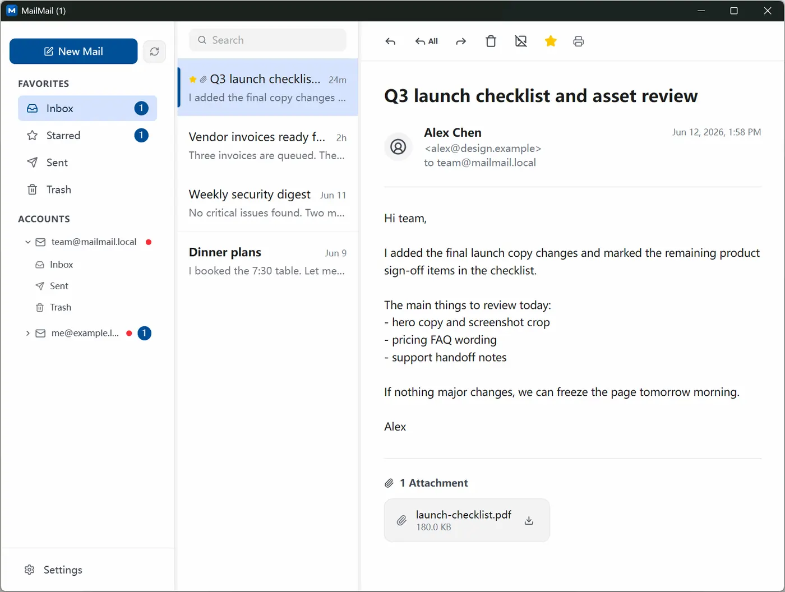

# MailMail Windows Client

A minimalistic, privacy-focused native Windows 11 email client built with Tauri v2, Rust, and React.



## Environment Requirements

- **OS**: Windows 11 (exclusively tested on Windows/MSVC).
- **Node.js**: 20.19+ on Node 20, 22.12+ on Node 22, or Node 24+.
- **PowerShell**: PowerShell 7 (`pwsh.exe`), as configured in `.npmrc`.
- **Rust**: The latest stable Rust toolchain (usually installed via `rustup`).
- **Build Tools**: Visual Studio C++ Build Tools with the Desktop development with C++ workload, and Microsoft Edge WebView2.

## Email account support

MailMail uses IMAP to receive mail and SMTP to send it. Use your provider's server settings and an app password if the provider requires one. Accounts that require OAuth2 are currently unsupported.

## Quick Start & Debugging

If you are a developer looking to run, test, or troubleshoot the MailMail client locally, follow these exact steps:

### 1. Install Node Dependencies
Ensure all frontend and Tauri CLI dependencies are installed:
```powershell
npm ci
```

### 2. Start the Development Server
This will automatically compile the Rust backend, bind to the Vite React dev server, and open the native Windows client:
```powershell
npm run tauri:dev
```

### 3. Build a Release Package
To build Windows installers for the version checked out locally, run `npm run tauri build`.

The release script below increments the patch version in the working tree, runs the frontend and Rust tests, builds the installers, and prints their paths.
```powershell
npm run build:release
```

### 4. Log Troubleshooting
If any background errors occur (e.g., IMAP sync failures, SQLite errors, TLS panics), you can view the backend Rust logs in the same terminal window where you ran `npm run tauri:dev`.

Before sharing logs or screenshots in a public issue, remove email addresses, message contents, mailbox names, and local paths. Account passwords are stored in Windows Credential Manager, and synced mail is cached in a local SQLite database. Keep that database and its companion files private.

## Project Structure
- `src-tauri/src/main.rs` & `imap.rs`: Core IMAP logic using `async-imap` and Tauri v2 IPC bindings.
- `src/`: The React 19 Frontend using `Tailwind CSS v4` and `lucide-react` for fully localized, offline UI rendering.
- `docs/`: Reference documentation on the architecture and migration status.
- **[docs/03_handover_status.md](docs/03_handover_status.md)**: Critical technical context for AI and developers.

## License

MailMail is distributed under the [MIT License](LICENSE).
